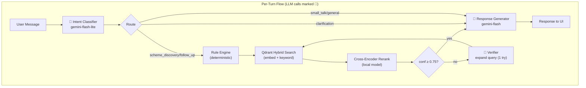

# JurisAI Architecture & Retrieval Review

## Executive Summary

The architecture plan in [agentic_workflow_notes.md](file:///Users/ratniel/JurisAI/SKILLS/agentic_workflow_notes.md) and the [v3 diagram](file:///Users/ratniel/JurisAI/docs/arch_diags/v3/jurisai_rag_arch_diag_v3.excalidraw.svg) are **sound and well-aligned**. The implementation in `src/agentic/` is clean, compiles, and follows the notes faithfully. Below is my analysis focused on your two goals: **excelling at retrieval** and **minimizing unnecessary LLM calls**.

---

## 1. Implementation Verification ✅

| Check | Result |
|---|---|
| `uv run python -m compileall src/` | **Passed** — zero errors |
| `TextGenerationClient` protocol | Correctly abstracts sync text, structured, and embedding calls |
| `GeminiClient` | Properly implements the protocol; sync/async/streaming/structured all present |
| `LlamaIndexGoogleGenAIClient` | Working adapter using `ThreadPoolExecutor` for sync bridge |
| `BasicAgenticWorkflow` | 4-step LlamaIndex workflow: classify → route → plan_tool / generate_reply |
| `UserIntentClassifier` | Uses `gemini-flash-lite` with structured output at `temperature=0` |
| `SessionSnapshot` / `OrchestratorDecision` | Clean Pydantic models with proper event types |
| `index_schemes_in_qdrant.py` | Supports local (sentence-transformers) and Gemini embedding backends |

---

## 2. What's Strong in the Plan

- **Deterministic routing in `_decide_next_action`** — the orchestrator dispatches based on classifier output, not open-ended LLM reasoning. This is the **single most important design for LLM-call minimization**.
- **Structured classifier output** — `UserIntentClassification` gives the orchestrator `primary_intent`, `needs_clarification`, `retrieval_query`, and `retrieval_filters` as machine-readable fields, not free text.
- **Provider-agnostic `TextGenerationClient`** protocol — swapping to LiteLLM later won't touch any workflow logic.
- **`gemini-flash-lite` for classification** — cheapest model for the most frequent operation.

---

## 3. Minimizing LLM Calls — Concrete Recommendations

The system currently has **2 LLM calls per turn** (classify + generate_reply). Here's how to keep it lean as features grow:

### 3a. Where LLM calls are necessary
| Call | Why it needs an LLM |
|---|---|
| **Intent classification** (every turn) | User language is ambiguous; heuristics alone can't route reliably |
| **Response generation** (every turn) | Natural-language synthesis with scheme data requires generation |
| **Verifier query expansion** (on low-confidence retrieval) | Needs semantic understanding to broaden queries intelligently |

### 3b. Where to avoid LLM calls

| Task | Use instead of LLM |
|---|---|
| **Metadata filter construction** | Deterministic rule engine from `user_profile` dict — map `state → level:state, provider:regex(state)`, map `category → tags`, map `age → age_range bucket`. No LLM needed. |
| **Retrieval query embedding** | The classifier already outputs `retrieval_query`. Embed that directly — don't ask an LLM to rephrase it. |
| **Keyword extraction for hybrid search** | Use the `tags` field from `SchemeDetails` + `user_profile` fields + classifier's `retrieval_filters`. Deterministic set union, not LLM extraction. |
| **Confidence scoring** | Use cosine similarity scores from Qdrant directly. Threshold at ≥0.75 without asking an LLM to judge relevance. |
| **Reranking** | Use a local cross-encoder (e.g., `cross-encoder/ms-marco-MiniLM-L-6-v2` via `sentence-transformers`), not an LLM-based reranker. Up to 50x cheaper and faster. |
| **Benefit calculation** | The v3 diagram's Calculator Agent should be pure Python arithmetic: parse numerical values from scheme `benefits` text via regex/structured extraction at indexing time, then sum at query time. |
| **Follow-up detection** | The classifier already sets `is_followup`. The orchestrator should use that flag directly — don't re-ask the LLM. |

### 3c. Per-turn LLM call budget

| Turn type | LLM calls | Notes |
|---|---|---|
| Normal scheme query | **2** | classify + respond |
| Low-confidence retry | **3** | classify + verifier expansion + respond |
| Profile update / small talk | **1** | classify only (deterministic response or template) |
| Follow-up on prior schemes | **2** | classify + respond (reuse prior retrieval + new context) |

---

## 4. Excelling at Retrieval — Pre-POC Strategy

### 4a. Dual-VDB architecture (matches v3 diagram)

| VDB | Content | Embedding model | Purpose |
|---|---|---|---|
| **Global schemes** (`schemes_vectors`) | 2 embeddings per scheme: description + FAQ | `gemini-embedding-001` or local `all-MiniLM-L6-v2` | Broad scheme discovery |
| **Late chunks** (new) | Long-context chunks of full scheme text | Long-context model (e.g., Jina `jina-embeddings-v3`) | Deep retrieval when user asks specifics about eligibility, application process, etc. |

### 4b. Retrieval pipeline (no extra LLM calls)

```
User message
    ↓
[Classifier] → retrieval_query, retrieval_filters, primary_intent
    ↓
[Rule Engine] → metadata_filters (deterministic from user_profile + classifier filters)
    ↓
[Qdrant Hybrid Search]
  ├── Semantic: embed(retrieval_query) → cosine search with metadata_filters
  └── Keyword: BM25/sparse on scheme name, tags, eligibility (Qdrant sparse vectors)
    ↓
[Merge + Deduplicate] → candidate schemes (union of both result sets)
    ↓
[Cross-Encoder Rerank] → top-K schemes with confidence scores
    ↓
[Confidence Check] ≥ 0.75? 
  ├── Yes → pass to response generator
  └── No → Verifier (1 LLM call: expand query + broaden filters) → re-search (1 attempt only)
```

### 4c. Key retrieval optimizations at indexing time

> [!IMPORTANT]
> These should be done **before** the POC to maximize retrieval quality:

1. **Structured metadata in Qdrant payloads** — Already storing `level`, `provider`, `tags`. Add:
   - `state` (extracted from `provider` field)
   - `category_tags` (normalized: education, agriculture, health, etc.)
   - `age_range` (extracted from eligibility text via regex at index time)
   - `gender_target` (extracted from eligibility: male/female/all)
   - `income_ceiling` (numeric, extracted from eligibility)
   
2. **Multiple embedding strategies per scheme** — Current script embeds `name + details + benefits + eligibility` as one document. Better:
   - **Embedding A**: `name + details` (what the scheme is)
   - **Embedding B**: `eligibility + benefits` (who qualifies and what they get)
   - **Embedding C**: FAQ answers (if available)
   
3. **Sparse vectors for keyword search** — Enable Qdrant hybrid with sparse vectors (BM25). The `name`, `tags`, and `eligibility` fields are keyword-heavy and benefit from exact matching.

4. **Pre-computed benefit summaries** — At indexing time, extract structured fields from `benefits` text (monetary amount, frequency, type) into payload metadata. This feeds the Calculator Agent without LLM calls at query time.

### 4d. Retrieval without LLM dependency

The entire retrieval pipeline from the classifier's `retrieval_query` through to ranked results should be **zero additional LLM calls** in the happy path:

- Embedding is a lightweight API call (not a generation call)
- Rule engine is pure Python dict construction
- Qdrant search is a vector/keyword operation
- Cross-encoder rerank is a local model forward pass
- Confidence check is a numeric threshold

Only the **verifier** (triggered on low confidence) adds an LLM call, and it's capped at 1 retry.

---

## 5. What's Needed Before the POC

### Already done ✅
- [x] `GeminiClient` with sync/async/structured/streaming
- [x] `TextGenerationClient` + `EmbeddingClient` protocols
- [x] `BasicAgenticWorkflow` with classify → route → respond
- [x] `UserIntentClassifier` with structured output
- [x] Qdrant indexing script with dual embedding backends
- [x] MongoDB models and `SchemeDetails` Beanie document
- [x] Architecture notes and v3 diagram

### Still needed for POC 🔲
- [ ] **Rule engine module** — deterministic `user_profile → metadata_filters` mapping (`src/retrieval/rule_engine.py`)
- [ ] **Qdrant retrieval client** — wraps `qdrant_client` search operations behind a protocol (`src/retrieval/qdrant_search.py`)
- [ ] **Cross-encoder reranker** — local model wrapper for reranking retrieved schemes (`src/retrieval/reranker.py`)
- [ ] **Retrieval agent step** — new workflow step in `BasicAgenticWorkflow` that actually performs `search → rerank → confidence check`
- [ ] **Enriched Qdrant payloads** — update `index_schemes_in_qdrant.py` to extract and store structured metadata (state, category, age_range, gender, income)
- [ ] **Verifier step** (optional for POC) — LLM-powered query expansion triggered on low confidence
- [ ] **End-to-end test** — given a user profile + message, verify the full pipeline produces ranked scheme results

### Can be deferred beyond POC ⏳
- Sparse vector (BM25) hybrid in Qdrant
- Late chunk VDB (#2 from v3 diagram)
- Calculator Agent for benefit arithmetic
- LiteLLM proxy routing
- Durable workflow checkpoints
- Streaming events to UI via SSE/WebSocket
- Multi-agent fan-out

---

## 6. Architecture Diagram Alignment



This shows exactly **where** LLM calls happen and where they don't. The retrieval pipeline center (Rule Engine → Qdrant → Reranker → Confidence Check) is entirely LLM-free.
