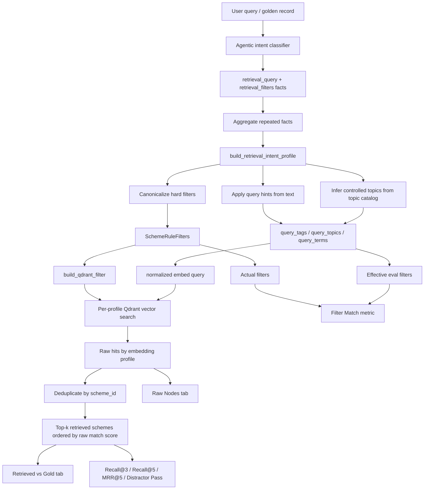

# Retrieval Eval Dashboard

## Purpose

The retrieval eval dashboard is the operator-facing UI for the first retrieval evaluation dataset.

It is meant to help us:

- inspect every golden record one by one
- compare expected labels against actual retrieval behavior
- understand classifier and rule-engine outputs
- inspect fetched schemes and raw retrieval nodes
- verify eval-collection coverage in the vector DB
- correlate runs with Phoenix traces

This dashboard now supports two run modes:

- `retrieval_core`: classifier + intent-profile + direct retrieval scoring
- `agentic_workflow`: live workflow scoring against the same retrieval metrics, using tool-called retrieval plus full trace and final answer capture

The current golden dataset is still a retrieval-focused dataset. Even in `agentic_workflow` mode, the numeric metrics are retrieval metrics only. Final answer quality and tool-calling quality will need a separate workflow-oriented dataset later.

## Current P0 Harness Direction

The next retrieval P0 pass should keep this dashboard as the shared harness surface.

It should eventually expose, for the active experiment:

- collection/version under test
- embedding model under test
- retrieval-query prompt/version under test
- the exported golden profile texts used for comparison
- per-profile similarity scores for the query variants being tried

The first focused experiment is the Vidarbha farmer query, not a broad multi-query sweep.

## Files

Core files for the dashboard:

- [scripts/run_retrieval_eval_dashboard.py](/Users/ratniel/JurisAI/scripts/run_retrieval_eval_dashboard.py)
- [src/eval/dashboard.py](/Users/ratniel/JurisAI/src/eval/dashboard.py)
- [src/eval/agentic_workflow_eval.py](/Users/ratniel/JurisAI/src/eval/agentic_workflow_eval.py)
- [src/retrieval/qdrant_search.py](/Users/ratniel/JurisAI/src/retrieval/qdrant_search.py)
- [.vscode/launch.json](/Users/ratniel/JurisAI/.vscode/launch.json)

Related evaluation artifacts and models:

- [docs/retrieval_eval_dynamic_plan.md](/Users/ratniel/JurisAI/docs/retrieval_eval_dynamic_plan.md)
- [eval/retrieval/personas_v1.yaml](/Users/ratniel/JurisAI/eval/retrieval/personas_v1.yaml)
- [eval/retrieval/shortlists_v1.yaml](/Users/ratniel/JurisAI/eval/retrieval/shortlists_v1.yaml)
- [eval/retrieval/golden_classifier_retrieval_v1.jsonl](/Users/ratniel/JurisAI/eval/retrieval/golden_classifier_retrieval_v1.jsonl)
- [src/eval/retrieval_dataset.py](/Users/ratniel/JurisAI/src/eval/retrieval_dataset.py)
- [evals/retrieval/runs/run_log.csv](/Users/ratniel/JurisAI/evals/retrieval/runs/run_log.csv)

The CSV run log is the canonical tabular ledger for persisted retrieval-core experiments.
It should be used for quick comparison across runs, while the per-run JSON artifacts remain the detailed debug source of truth.

## What The Dashboard Shows

### Run Overview

This is the top-level evaluation summary for the current run.

It includes:

- eval mode
- intent provider and model
- generation provider and model
- record count
- average `Recall@3`
- average `Recall@5`
- average `MRR@5`
- distractor pass rate
- expected filter match rate
- classifier error count
- Phoenix project name

It also shows a readable per-record summary table so weak records are easy to spot quickly.

`Filter Match` is based on the effective retrieval constraints, not only the hard Qdrant filter.
That means the dashboard compares expected filters against:

- hard applied filters such as `state`, `level`, and explicit `tags`
- inferred `query_topics`
- inferred `query_tags`

This matters because topic intent like `Education` is still part of eval-side intent checking even when it is not emitted as a hard `topics` filter.

### Collection Coverage

This is the full-width table for the eval subset stored in Mongo and indexed in Qdrant.

It shows:

- scheme name
- scheme id
- level
- state
- topics
- whether the scheme is present in the vector DB
- vector count
- embedding profiles present

The sidebar keeps only the compact coverage summary. The full coverage table lives in the main content area so it can use the full width of the screen.

### Record Inspector

This is the main debugging view for a single golden record.

It shows:

- the original user query
- generated retrieval query
- generated embed query
- expected filters
- actual filters
- applied filters
- ignored filters
- classifier output or fallback error
- raw node count
- final retrieved schemes
- gold positives and distractors
- raw fetched nodes by embedding profile
- a chat-style trace view of the eval steps for that record
- any captured workflow trace or final answer fields when present in the run artifact
- record-level trace id

The trace chat is retrieval-eval aware:

- it shows the user query, classifier output, retrieval call inputs, and a brief result summary in chat form
- it does not invent hidden reasoning or chain-of-thought
- in `retrieval_core` mode, final answer generation is usually not present because the run stops after retrieval scoring
- in `agentic_workflow` mode, the trace can include workflow steps, tool outputs, and the final generated answer

For the upcoming P0 experiment loop, the record inspector should remain the place where we verify:

- the generated retrieval query
- the normalized topics
- the applied metadata filters
- the vector profile texts being targeted
- the similarity outcome for the chosen prompt/model variant

## Status Colors

The retrieved and gold comparison views use light color cues:

- green: correct positive hit or successful blocking
- red: missed gold or retrieved distractor
- amber: retrieved but not part of the gold set

## Auto Refresh

Auto refresh is enabled by default.

Current behavior:

- refreshes the coverage summary and collection coverage table every 10 seconds
- does **not** automatically rerun the full evaluation loop
- supports a `Stop run` button to cancel an in-flight eval from the dashboard

This keeps the dashboard lightweight while still updating collection coverage when indexing changes underneath it.

## Retrieval Pipeline Flow



## Launching The Dashboard

### Terminal

From the repo root:

```bash
/Users/ratniel/JurisAI/.venv/bin/python /Users/ratniel/JurisAI/scripts/run_retrieval_eval_dashboard.py --host 127.0.0.1 --port 7860 --trace-project jurisai-retrieval-eval-dashboard
```

Then open:

- [http://127.0.0.1:7860](http://127.0.0.1:7860)

### VS Code Run Button

A launch profile is available in:

- [.vscode/launch.json](/Users/ratniel/JurisAI/.vscode/launch.json)

Use the `Retrieval Eval Dashboard` configuration in Run and Debug.

That configuration:

- uses the project virtualenv
- launches the dashboard script from the workspace root
- binds to `127.0.0.1:7860`
- uses the Phoenix project `jurisai-retrieval-eval-dashboard`

## Phoenix Traceability

Dashboard-triggered evaluation runs are instrumented through the existing Phoenix tracing setup.

The dashboard uses:

- [src/observability/phoenix_tracing.py](/Users/ratniel/JurisAI/src/observability/phoenix_tracing.py)

Each run records:

- a run-level trace id
- a run-level span id
- record-level trace ids
- record-level span ids
- retrieval spans
- Qdrant profile-query spans
- classifier spans

### Required environment

For traces to actually appear in Phoenix, configure:

- `PHOENIX_COLLECTOR_ENDPOINT`

And for Arize Phoenix cloud:

- `PHOENIX_API_KEY`

The dashboard also lets you override:

- Phoenix project name
- Phoenix collector endpoint

from the left-side controls.

### Reading traces

Use the trace ids shown in the dashboard:

- `Run trace id` in the run summary
- `Run span id` in the run summary
- `Trace id` in the record inspector
- `Span id` in the record inspector

Use the trace id to find the overall run in Phoenix. Use the span id to pinpoint the exact run span or record span inside that trace.

## Data Sources

The dashboard reads from three places:

### Canonical reviewed artifacts

- [eval/retrieval/personas_v1.yaml](/Users/ratniel/JurisAI/eval/retrieval/personas_v1.yaml)
- [eval/retrieval/shortlists_v1.yaml](/Users/ratniel/JurisAI/eval/retrieval/shortlists_v1.yaml)
- [eval/retrieval/golden_classifier_retrieval_v1.jsonl](/Users/ratniel/JurisAI/eval/retrieval/golden_classifier_retrieval_v1.jsonl)

### MongoDB

For the enriched eval subset:

- `eval_persona_schemes_enriched_v1`

### Qdrant

For actual retrieval and coverage checks:

- `eval_persona_schemes_vectors_v1`

## Retrieval Debug Output

The dashboard relies on extra debug output added to the Qdrant client.

The retrieval result now includes:

- `raw_hit_count`
- per-profile raw hits
- deduped hits
- query vector dimensionality

This is what powers the raw node view and the fetched-schemes debugging tables.

## Troubleshooting

### The dashboard starts slowly

The local embedding stack used to be imported too early. That was changed to lazy-load the sentence-transformers dependency, so startup should be much faster now.

Relevant files:

- [src/llm/__init__.py](/Users/ratniel/JurisAI/src/llm/__init__.py)
- [src/llm/providers.py](/Users/ratniel/JurisAI/src/llm/providers.py)
- [src/llm/local_embedding_client.py](/Users/ratniel/JurisAI/src/llm/local_embedding_client.py)

### Port already in use

If Gradio reports that it cannot bind to `7860`, another dashboard process is probably still running.

Either:

- stop the old process
- or launch on a different port

Example:

```bash
/Users/ratniel/JurisAI/.venv/bin/python /Users/ratniel/JurisAI/scripts/run_retrieval_eval_dashboard.py --host 127.0.0.1 --port 7865 --trace-project jurisai-retrieval-eval-dashboard
```

### Classifier quota errors

If Gemini quota is exhausted:

- the scorer and dashboard fall back to raw-query retrieval for that record
- classifier error details are shown in the record inspector

This lets the evaluation continue even when model quota is temporarily constrained.

## Current Scope

The current UI covers:

- seed dataset inspection
- collection coverage inspection
- record-by-record evaluation debugging
- Phoenix trace correlation

It does not yet include:

- direct Phoenix deep links
- orchestrator-level eval visualization
- bulk comparison between multiple saved runs
- advanced filters inside the coverage table

Those can be added later once the retrieval dataset stabilizes.
