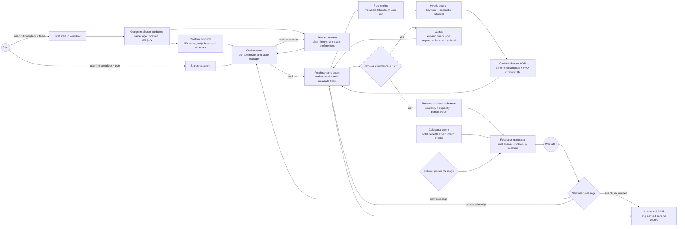

# Agentic Workflow Notes

This note translates the current JurisAI architecture sketch into concrete building blocks using:

- LlamaIndex workflows docs: <https://developers.llamaindex.ai/python/llamaagents/workflows/>
- Google Gen AI Python SDK: <https://github.com/googleapis/python-genai>
- LiteLLM proxy docs: <https://docs.litellm.ai/>

## Architecture diagram

## What each LlamaIndex workflow branch is useful for

### 1. Basic workflows

- Use this as the base mental model for the orchestrator: event-driven steps, each step takes an event and emits the next event.
- Good fit for your per-turn routing logic because the orchestrator is not a free-form agent loop; it is a bounded state machine with known transitions.

### 2. Branches and loops

- This maps directly to your `retrieval -> verify -> retry` cycle.
- Use it for bounded refinement loops only. Put a strict retry cap in code so the orchestrator does not spin.

### 3. Managing state

- Use workflow `Context` for per-session, short-lived state: current user profile snapshot, current intent, current filters, retrieved candidates, retry count.
- Do not use workflow state as your long-term source of truth. Persistent user profile and conversation memory should stay in Mongo/Beanie.

### 4. Streaming events

- This is the clean mapping for UI progress updates over SSE/WebSockets.
- Emit events like `intent_classified`, `retrieval_started`, `retrieval_refined`, `ranking_completed`, `response_ready`.

### 5. Concurrent execution

- Useful later when you query multiple retrieval paths in parallel:
- global VDB semantic search
- keyword search
- FAQ-focused retrieval
- late-chunk retrieval
- Avoid using concurrency in Step 1 unless you already have at least two independent retrieval paths worth parallelizing.

### 6. Human in the loop

- Strong fit for your onboarding and clarification path.
- If you want workflow-native pause/resume, use `InputRequiredEvent` when the system must stop and wait for the user.
- If the UI already owns request/response turns, you can keep Step 1 simpler and treat each user message as a fresh workflow run with persisted session state outside the workflow engine.

### 7. Custom entry/exit points

- Useful if you want the same orchestrator to be resumed from different states:
- fresh user turn
- resumed clarification turn
- resumed retrieval verification turn
- This is helpful once the flow grows, but optional in the first iteration.

### 8. Drawing workflows

- Use this immediately. It forces explicit state transitions and catches accidental dead ends.
- Keep a local Mermaid diagram for product/design discussions, then separately generate workflow graphs from the actual LlamaIndex workflow code later.

### 9. Resource objects

- Use resource objects for shared infra handles:
- vector store clients
- reranker clients
- calculator service
- Mongo repositories
- This keeps steps small and testable.

### 10. Retry policy

- Use retry policy for transient failures only: network hiccups, model API failures, temporary DB errors.
- Do not use retry policy for low-confidence retrieval logic. That belongs in explicit verifier loop logic because it is business behavior, not infrastructure recovery.

### 11. Server and client mode

- Useful later if you want the orchestrator or heavy retrieval agent running as a separate service.
- Not needed for Step 1 inside this repo. Keep the first implementation in-process.

### 12. Checkpointing and durable workflows

- Valuable once you need long-lived pause/resume across process restarts, especially for human clarification or multi-step application assistance.
- Probably not worth the complexity in Step 1 unless you already know a single workflow run may span minutes or hours.

### 13. Async support

- Important for your stack because model calls, DB calls, and retrieval calls are all I/O-heavy.
- Step 1 should be async-first even if the first code path is simple.

### 14. Observability

- Add once the orchestrator exists and before multiple specialized agents appear.
- This becomes useful quickly when debugging why the orchestrator chose a specific branch.

## What should live inside LlamaIndex workflows vs outside

### Keep inside the workflow

- Per-turn orchestration logic
- Intent classification result for the current turn
- Routing decisions
- Retrieval refinement loop
- Progress events for the UI
- Temporary working memory for the current turn

### Keep outside the workflow

- FastAPI routes / WebSocket / SSE transport
- Mongo persistence and Beanie models
- User profile storage
- Session history storage
- Vector DB indexing jobs
- Rule engine definitions and deterministic eligibility helpers
- Provider-specific LLM wiring

## What is useful for JurisAI later

- Workflow-native streaming for UI visibility
- Explicit verifier loop for low-confidence retrieval
- Parallel retrieval across multiple indexes or query strategies
- Human-in-the-loop pause/resume for clarification-heavy onboarding
- Durable checkpoints if a session can pause for long periods
- Workflow diagrams and observability once more than one specialized agent exists

## Recommended architecture boundaries

### Orchestrator

- Owns the turn graph.
- Decides whether the system should:
- clarify user intent
- enrich user profile
- retrieve schemes
- verify low-confidence retrieval
- calculate benefit totals
- generate the final answer

### User intent classifier

- Runs on every user prompt.
- Should stay lightweight and cheap.
- Output should be structured, small, and deterministic enough for routing.
- Suggested fields:
- `primary_intent`
- `needs_clarification`
- `is_scheme_discovery`
- `is_followup`
- `should_update_user_profile`
- `mentions_location`
- `mentions_life_status`
- `mentions_numeric_constraint`

### Retrieval agent

- Should be deterministic where possible.
- Accepts current user profile snapshot plus intent classifier output.
- Produces candidate schemes and confidence score.

### Verifier

- Owns only recovery behavior for poor retrieval.
- Broadens filters, expands keywords, or asks one targeted clarification question.

### Response generator

- Should not decide retrieval strategy.
- It should consume already-ranked schemes plus calculation outputs and produce the user-facing answer.

## Step 1 recommendation

Implement only these two pieces first:

1. A small async orchestrator that accepts the current user message plus persisted session snapshot and returns the next action.
2. A lightweight structured intent classifier called on every turn before any heavier retrieval or reasoning step.

Step 1 should not yet include:

- full multi-agent autonomy
- durable checkpoints
- remote workflow server/client split
- concurrent retrieval fan-out
- LiteLLM proxy routing

## How Gemini and LiteLLM fit

### Gemini now

- Use the official `google-genai` SDK directly for the first iteration.
- Keep the call surface tiny so you can swap transport later.
- Use `gemini-2.5-flash` for intent classification and simple orchestration decisions.
- Reserve a stronger model like `gemini-2.5-pro` only for harder synthesis or ambiguous cases.

### LiteLLM proxy later

- Good fit when you need centralized model routing, fallback rules, logging, spend controls, and provider abstraction.
- Do not let the orchestrator depend directly on LiteLLM semantics. Put a local `LLMClient` interface in front of it.
- That way:
- Step 1 uses `google-genai`
- later you can swap to LiteLLM proxy
- later still you can route some agents to Gemini and others to different models

## Immediate implementation direction

- Create an `LLMClient` abstraction with `generate_text`, `generate_structured`, and `stream_text`.
- Put the current Gemini implementation behind it.
- Build the intent classifier on structured output, not regex heuristics.
- Keep the orchestrator mostly deterministic and state-driven, not prompt-driven.
- Feed the orchestrator the classifier output, session snapshot, and retrieval confidence instead of letting it infer everything from raw chat history every time.
